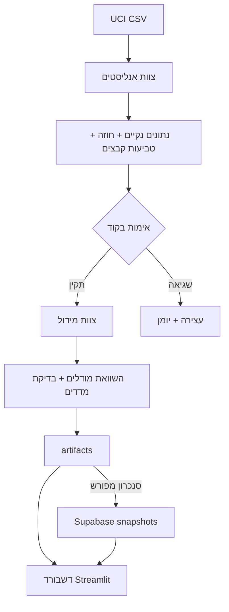

# ארכיטקטורה וסוכנים

## צוות האנליסטים — analyst_crew.py

1. **Data Cleaning Analyst** — מפעיל את כלי הניקוי.
2. **Exploratory Data Analyst** — מפיק ניתוח וגרפים.
3. **Dataset Contract and Insights Publisher** — מפרסם חוזה, מסירה ותובנות.

## צוות המידול — scientist_crew.py

1. **Modeling Input Inspector** — בודק קלט וחוזה.
2. **Model Training Scientist** — מפעיל את כלי האימון והשוואת המודלים.
3. **Model Evaluation Reviewer** — מאמת מדדים ומסביר מגבלות.

הסוכנים משתמשים ב־Claude דרך CrewAI; החישובים עצמם מבוצעים בקוד Python. ההגדרה לדוגמה היא `MODEL=anthropic/claude-sonnet-4-6`. מפתחות נשמרים מקומית מחוץ ל־Git, נטענים לסביבת תהליך השרת ונמסרים ללקוח ה־API; אין בידוד של מערכת ההפעלה בין הצוותים.

`project_flow.py` מנהל את סדר העבודה ואת `ProjectState`, מתעד אירועים בקובץ `flow_<id>.json`, בודק שהתוצרים עודכנו ושהדוחות הסתיימו בסמן המצופה. כישלון במעבר מונע הפעלת צוות המידול.

שכבת הממשק החדשה נפרדת מכלי החישוב: `dashboard_data.py` קורא ומסנן, `dashboard_theme.py` שומר עיצוב, `supabase_store.py` מטפל בארכיון הענן. טעינת דשבורד אינה מפעילה סוכנים.

מ־16.10.2026, `app_security.py` דורש קוד גישה לפני טעינת הדשבורד ו־`workspace_runtime.py` נועל את ההרצה המלאה והכנת תמונות המצב. `train_model.py` בודק טביעות מסירה גם בכניסה ישירה. פירוט: [[11 - אבטחה והקשחה]].

קשור: [[03 - חוזה ומסירה]], [[05 - עיצוב וחוויית משתמש]], [[06 - Supabase]].
